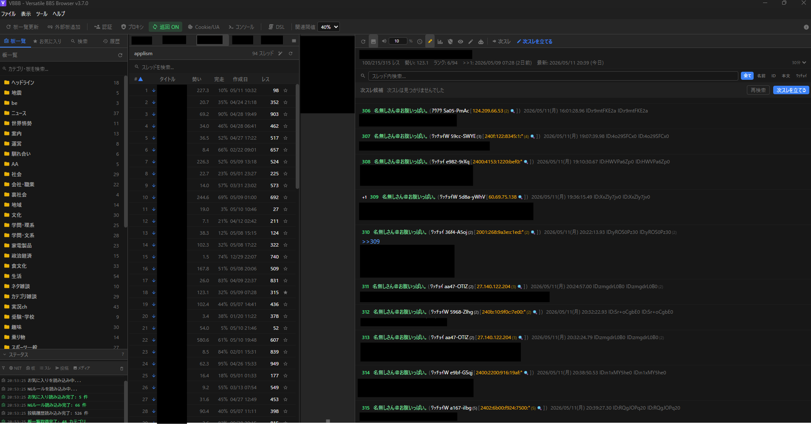

# VBBB - 汎用掲示板ブラウザ

2ch/5ch 系掲示板を閲覧・投稿するためのデスクトップアプリケーション。

## 主な機能

- レス中の画像をサムネイル表示し、専用ビューアで拡大・保存・複数画像切り替え
- 動画・音声リンクを専用プレイヤーウィンドウで再生
- 次スレ検出・ここまで読んだ・NG・タブ管理など、専ブラ向けの基本機能を搭載

## ダウンロード

最新リリースは [Releases](../../releases) からダウンロードできます。

- **Windows 10/11 (x64)** — `VBBB-Setup-x.x.x.exe`

> Linux / macOS 向けバイナリは公式には提供していません。
> 自前ビルドについては下記「[自前ビルド](#自前ビルド)」を参照してください。

## 自前ビルド

### Windows (推奨・動作確認済み)

```bash
bun install
bun run build:win
# → release/ に NSIS インストーラー (.exe) が生成されます
```

### Linux ⚠️ 自己責任

> **警告**: Linux 向けビルドは動作確認を行っていません。ビルド・実行は自己責任でお願いします。
> 不具合報告は歓迎しますが、サポートは保証できません。

```bash
bun install
bun run build:linux
# → release/ に AppImage が生成されます
```

### macOS ⚠️ 自己責任

> **警告**: macOS 向けビルドは動作確認を行っていません。ビルド・実行は自己責任でお願いします。
> コード署名なしのビルドのため、Gatekeeper の警告が表示される場合があります。
> 不具合報告は歓迎しますが、サポートは保証できません。

```bash
bun install
bun run build:mac
# → release/ に .dmg が生成されます
```

## ライセンス

[MIT](LICENSE)

## 開発・運用の知見

開発環境、内部構成、検証コマンドと運用上の注意は [findings.md](findings.md) を参照してください。更新・復旧の手順と検証記録は、同ファイルから案内しています。
